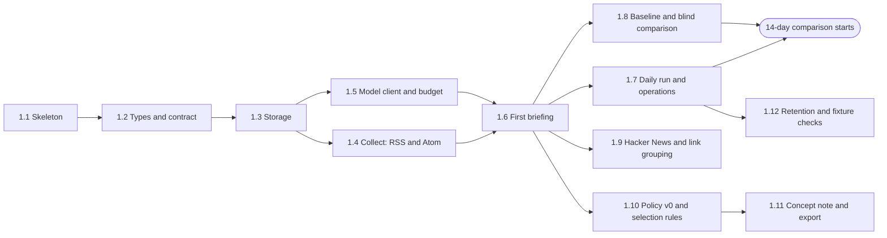

# AI Briefing — milestone plan and issue breakdown

**Status:** Approved by the owner on 2026-11-21, with [RFC v0.3](../rfc/AI-Briefing-RFC-v0.3.md). Replaces the v0.2 "M1 — Foundation & offline editorial evaluation" plan.

No implementation has started. Do not create GitHub issues or run `/round` until the architecture pull request is merged and the owner explicitly authorises development.

## Principles

- Each milestone ends with something the owner can observe or use.
- One issue and one pull request per independently testable unit, with a done-when the owner can check.
- The first real briefing comes as early in M1 as it safely can. Everything after it extends the same code; nothing is built to be thrown away.
- M0 and M1 are broken down to issues here. Later milestones list scope and exit criteria; their issues are written when the milestone starts.
- All pull requests are merged by the owner until ADR-011 Phase B is enabled.

## Sequence

| Milestone | Delivers | Depends on |
|---|---|---|
| M0 | Repository safeguards, agent workflow, model and source configuration | Owner acceptance of the architecture |
| M1 | A daily briefing and a baseline digest on the development machine | M0 items marked "before M1" |
| M2 | Pi deployment, morning email, feedback, backup and restore | M1 gate (below); host verification |
| M3 | Story grouping, corroboration, full policy, reassessment | M1 data; M2 running |
| M4 | Prospective evaluation and quality improvement | M2 feedback path; several weeks of data |
| M5 | Expanded discovery and targeted research | Gaps measured in M4 |
| M6 | Persistent curriculum and progress | M2 feedback path; M4 findings |

---

## M0 — Safeguards and minimal preparation

Target: about a week of part-time work. M0 is done when the "before M1" items are done. None of it is implemented in the architecture pull request.

These changes all touch protected paths and come before the protections exist, so they are ordinary owner-requested pull requests, reviewed and merged by the owner. `/round` is not used in M0.

### Recommended order

| Step | Work | Who | Done when |
|---|---|---|---|
| 1 | Merge the architecture pull request. RFC v0.3 and ADRs 001–011 were accepted on 2026-11-21. | Owner | Merged |
| 2 | Confirm the private benchmark answer key is not on any machine or account where a coding agent runs | Owner | Confirmation recorded. Do this before any further agent session; it takes minutes and is the one risk that cannot be undone. |
| 3 | **PR A — licence and project files:** Apache-2.0 `LICENSE`, `NOTICE`, `SECURITY.md`, README | Agent, owner review | Merged |
| 4 | **PR B — agent instructions:** `AGENTS.md` and `CLAUDE.md` with project rules, commands, hard limits and the Codex review section from ADR-011 | Agent, owner review | Merged |
| 5 | **PR C — CI and ownership:** lint, types, tests, a guard that fails tests on network access, secret scanning, `CODEOWNERS` for the protected paths, the merge-eligibility job in report mode | Agent, owner review | Merged; checks run on the pull request itself |
| 6 | Apply the ruleset on `main` (pull request required, the checks from step 5 required on an up-to-date branch, conversations resolved, linear history, no force push). Enable the Codex review app for the repository. | Owner | A test pull request with a failing check cannot merge; Codex reviews it; the eligibility job reports correctly for one protected and one unprotected change |
| 7 | **PR D — `/round` port** with no merge step, its two helper scripts and one configuration file | Agent, owner review | A dry run lists a test milestone's issues and plan; the skill text contains no merge command |
| 8 | Complete the terms record for each of the nine sources in the [approved selection](source-catalogue-draft.md). The editorial selection itself was approved on 2026-11-21. | Owner | Records returned; a source without one stays disabled |
| 9 | **PR E — configuration:** `config/models.yaml` (model identifiers and the verified price table from RFC §7) and `config/sources.yaml` with the nine approved sources (arXiv as `cs.CL` only), every source disabled until its terms record is complete | Agent, owner review | Merged |
| 10 | Create an Anthropic API key for AI Briefing with a provider-side spend limit. Store it outside the repository. | Owner | A one-line smoke call succeeds from the development machine |

Steps 3 and 4 can be prepared together. Step 6 needs step 5 merged first, because the ruleset must name checks that exist. Step 8 can start any time and is the only step likely to wait on the owner's reading time. M1 can begin with whichever sources have been enabled by then.

### Gate M2, not M1

Start whenever convenient; they do not hold up M1.

| # | Item | Who | Done when |
|---|---|---|---|
| 0.11 | Host inventory per ADR-008: OS and architecture as installed, storage medium and free space, memory and CPU over a day, MLflow server version | Owner | A short record in `docs/operations/` |
| 0.12 | Check that the lightweight MLflow tracing client can log to the running server, and that a job completes with the server stopped | Owner with an agent-prepared script | Result recorded; client version range chosen |
| 0.13 | Decide the data directory's storage (Q1) and the off-device backup destination (Q2) | Owner | Decisions recorded |

### Deliberately not in M0

- Volume and cost measurement, the story-grouping trial and the first look at run-to-run variability. They need the M1 collector on real sources; doing them earlier would mean building a throwaway.
- The agent identity and isolated environment for automatic merging (ADR-011 Phase B).
- Anything on the Pi.

---

## M1 — Working daily briefing and baseline

**Goal:** a real, readable daily briefing from real sources on the development machine, as early as possible, then a 14-day blind comparison against a single-prompt digest while the system is hardened around it.

**Not in M1:** the Pi, Home Assistant, feedback files, topic-based grouping, source-role corroboration rules, escalation, MLflow, judges, the benchmark harness.

### Shape

### Stage A — first briefing (issues 1.1 to 1.6)

The thinnest slice that is safe to run against real sources and a paid API: feeds in, one briefing out, with the budget and citation rules already in force.

| # | Issue | Depends on | Done when |
|---|---|---|---|
| 1.1 | Package and CLI skeleton | M0 | `ai-briefing --help` works from a clean clone; CI is green |
| 1.2 | Domain types and briefing contract: typed records and enumerations; `daily_briefing.v1` JSON Schema with valid and invalid fixtures | 1.1 | The import-boundary test passes; fixtures validate or fail as labelled |
| 1.3 | Storage core: schema and first migration for sources, documents, observations, stories and membership events, assessments with inputs and evidence, decisions, briefings, model calls and job runs; SQLite settings; file lock; idempotency keys | 1.2 | Upgrade and downgrade pass; running a job twice with one key adds no rows |
| 1.4 | Collection: catalogue loader, fetcher with the network policy, RSS and Atom adapter with conditional requests, exact deduplication | 1.3 | Private-address and redirect tests pass; re-collecting recorded feeds adds no documents; one failing source does not fail the run; a disabled source is never fetched |
| 1.5 | Model client: Anthropic, structured output, `LLMCall` log, price table, budget pre-check, refusal handling, recorded-response replay | 1.3 | A call that would exceed the cap is refused and recorded; a refusal is recorded and does not fail the run; the client runs in CI from recorded responses with no key |
| 1.6 | **First briefing:** screening; standard assessment with ID-only citations, input snapshots and the quote-integrity check; selection by class; Markdown and JSON rendering | 1.4, 1.5 | From recorded fixtures, CI produces a schema-valid briefing with no network. On the development machine, one command sequence produces a briefing from the approved sources. A citation to an ID not in the input is rejected; a quote not in the stored text is marked failed and gives no support. |

1.4 and 1.5 are independent and can proceed in parallel. In this stage each document is its own story; the membership-event table already exists, so 1.9 adds grouping without changing the schema.

**The first real briefing exists when 1.6 merges.**

### Stage B — make it daily and start the comparison (issues 1.7 and 1.8)

| # | Issue | Depends on | Done when |
|---|---|---|---|
| 1.7 | Daily run and operations: one command for the day's jobs, structured JSON logs, `doctor`, `budget status` | 1.6 | The day's run is one command; `budget status` equals the sum of recorded calls; re-running the day adds no rows |
| 1.8 | Baseline digest and blind comparison: `baseline generate`, `compare`, `ComparisonJudgment` | 1.6 | Two unlabelled briefings are shown in random order; the choice and the hidden order are stored |

**The 14-day comparison starts when 1.7 and 1.8 have merged.** Each day's record carries the prompt and policy hashes in force, so changes made during the window are visible in the exit report.

### Stage C — harden around the running system (issues 1.9 to 1.12)

These land while the comparison is running. Each extends a module that already exists.

| # | Issue | Depends on | Done when |
|---|---|---|---|
| 1.9 | Hacker News adapter; canonical URLs; link-based story grouping recorded as membership events | 1.6 | A feed item and a Hacker News item linking to it form one story; an item on an uncatalogued host has no stored body |
| 1.10 | Policy v0 and selection rules: ceilings for no verified evidence, metadata-only and community-only stories; freshness window; repetition; title-similarity suppression | 1.6 | Table-driven tests cover each rule; a story already briefed does not reappear without a material update |
| 1.11 | Concept note; atomic export with a dated archive | 1.10 | Output validates against the schema; a concept is not repeated within 30 days; exporting twice leaves one current file |
| 1.12 | Retention purge; fixtures licence manifest check; no-op tracer protocol | 1.7 | After the purge no body older than its retention remains and hashes do; CI fails on an unlisted fixture file |

Issues 1.5, 1.6, 1.8, 1.10 and 1.11 include prompts, policy or model configuration, which are protected paths. The owner reviews those closely in any phase.

### Acceptance criteria

**Build criteria** — checkable as soon as the issues merge:

1. From a clean clone with no network and no API key, one command sequence produces a schema-valid briefing from recorded fixtures. CI runs this.
2. Re-running any day's jobs adds no rows.
3. A query for briefing URLs that do not match a stored document returns nothing.
4. A query for briefing items supported by a failed evidence item returns nothing.
5. A query for stored bodies from sources that do not permit them returns nothing.
6. Month-to-date spend is under the cap and `budget status` agrees with the sum of recorded calls.
7. The network-policy tests pass.

**Validation criteria** — need elapsed time:

8. A pipeline briefing and a baseline digest are stored for 14 consecutive days.
9. Each of those days has a recorded blind preference.
10. The M1 exit report is written and the owner has decided how to proceed.

### M1 exit report

Short, written by the owner with agent help:

- Items per day per source; tokens and cost per stage; projected monthly cost against $15.
- Preference tally against the baseline, with the count and an interval.
- Observed failure types: duplicates, misgrouped stories, weak evidence, misses the owner noticed.
- Results of the grouping trial and the variability check.
- A recommendation: proceed to M2, or simplify first if the baseline is preferred.

### What may overlap, and what may not

| Activity | May begin | Condition |
|---|---|---|
| M2 preparation in this repository (image build, Compose and timer units, backup command, feedback schema and ingestion, tracer, consumer guide) | Once build criteria 1–7 pass and the comparison is running | Nothing is deployed or run on the Pi |
| Host checks 0.11–0.13 | Any time | Owner-performed |
| **M2 deployment to the Pi** | Only when the owner authorises it | All ten M1 criteria pass, including the completed comparison and the owner's decision to proceed; and the deployment safeguards in the M2 gate pass |

---

## M2 — Pi deployment, email delivery, feedback and recovery

**Goal:** the briefing arrives in the existing 07:00 email, feedback flows back, and the data survives a disk failure.

### Preparation (may overlap the M1 comparison)

- ARM64 container image built in CI; Compose project; systemd timer units; resource limits; deployment guide.
- Host preflight checks in `doctor`.
- Backup command and documented restore.
- Dated export archive and staleness semantics.
- Degraded and budget-exhausted behaviour from RFC §7.
- `feedback_event.v1` schema, fixtures and ingestion.
- MLflow tracer implementation, with the unreachable-server test.
- Consumer guide and contract fixtures for the Home System.

### Deployment gate

The owner authorises deployment only when all of these hold:

1. M1 criteria 1–10 pass and the owner has decided to proceed.
2. Host inventory recorded (0.11) and the data directory is on reliable storage, not the boot microSD (Q1).
3. An off-device backup destination exists (Q2) and a restore from it has succeeded.
4. MLflow client compatibility is known (0.12), or tracing is left disabled.
5. Email placement (Q4) and feedback authentication (Q5) are decided.

### Deployment

- Deploy the container and timers by hand.
- In the Home System repository, by the owner: read and render the briefing section; the authenticated feedback page; the two directory mounts.

### Exit criteria

1. On seven consecutive healthy days, the 07:00 email contains the full briefing with source links.
2. With the export file removed, corrupted, or dated yesterday, the email is sent with its existing content only.
3. Opening the feedback link records nothing. Pressing a control records one event, which appears as one row after ingestion.
4. A restore from the off-device backup onto a clean directory passes `doctor`.
5. A job with tracing enabled completes with the MLflow server stopped.
6. The container stays within its memory limit for a week.

---

## M3 — Story grouping, evidence and editorial policy

**Goal:** stories persist and update correctly, and the policy enforces the evidence-first promise.

Scope:

- Lexical shortlist and constrained model match for grouping; merge and correction handling.
- Source roles applied to documents; independent corroboration count; full ceiling rules from RFC §6.2.
- Escalation to the capable model under budget.
- Reassessment and re-decision triggers; material-update rule for repeat coverage.
- Provenance view: from a briefing item to its decision, assessment, inputs and evidence.

Exit criteria:

1. A scripted fixture day containing a syndicated duplicate, a genuine update to an earlier story, a vendor-only performance claim and a metadata-only community item produces the specified briefing.
2. Over 14 live days, no briefing item is supported by a failed evidence item and no vendor-only comparative claim exceeds `watch`.
3. After a merge, earlier assessments still resolve to the observations they saw.
4. Changing the policy version re-decides open stories with no model calls.

---

## M4 — Prospective evaluation and quality improvement

**Goal:** a trustworthy baseline with stated uncertainty, and a way to tell whether a change helped.

Scope:

- Weekly labelling worksheet: sampling, blind presentation, import.
- Reference-set comparison and the recall funnel.
- 30- and 90-day revisit of `major` and lead items.
- Run-to-run variability measurement and the noise band.
- Evaluation result file format; optional logging to MLflow.
- Tier 1 workflow, started by the owner.
- The 12 public benchmark cases wired in as a smoke test. The private cases stay outside the repository and are used only by the owner (ADR-007 §5).
- Experimental judges, diagnostic only, with agreement reporting.

Exit criteria:

1. A baseline report exists in which every figure has a sample size and an interval.
2. Integrity failure rate and human-labelled support rate are reported separately.
3. One prompt or policy change has been compared against the baseline through Tier 1, and the owner decided using the noise band.
4. Any judge output is marked diagnostic and shown with its measured agreement and sample size.

---

## M5 — Expanded discovery and targeted research

**Starts only if** M4 shows important stories that were never collected, or stories that stayed at `watch` for lack of evidence that existed elsewhere.

Candidate scope, chosen from the measured gap: more curated sources; a page-based adapter for providers without feeds; another community source; search-provider discovery; one bounded research step in which the model proposes queries, code runs them against an allowlisted API, and the story is reassessed once.

Exit criterion: the targeted measure (recall at a named stage, or the share of under-evidenced stories) improves by more than the noise band, within the budget.

Each addition needs its own ADR or an amendment to ADR-003.

---

## M6 — Persistent curriculum and progress

**Starts when** the briefing is in daily use, the feedback path works, and ADR-005's curriculum design has been re-reviewed.

Scope: one hand-reviewed track delivered in order; the five progress states; a next-day recall check through the feedback path; deterministic news-to-lesson rules; a periodic report of recurring concepts with no lesson, seeded by concept keys stored since M1.

Exit criteria:

1. Lessons are delivered in order for 14 days and resume correctly after an interruption.
2. No progress state is recorded without its required evidence.
3. Recall checks are answered through the feedback path and stored.

<!-- Disposable safeguard validation B. Not for merging. -->
