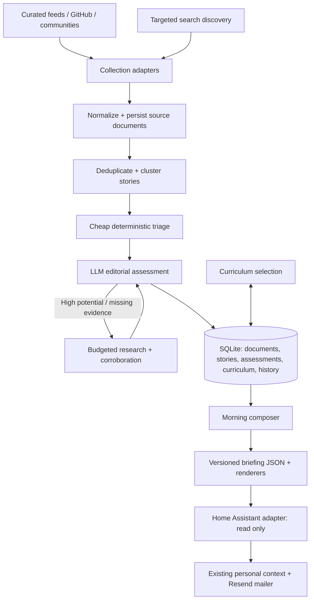

# AI Briefing — RFC v0.1

**Status:** Proposed for owner and independent architecture review; NOT approved for implementation  
**Date:** 2026-11-19  
**Target repository:** `ai-briefing` (not yet created by this document)  
**Initial deployment:** `homenvr`, the Home System Raspberry Pi 4B (8 GB)  
**Related project:** `sdeery14/personal-home-system`, especially its `morning-briefing-email` feature  
**Benchmark:** AI Briefing Editorial Benchmark v0.1 (40 seed candidate cards; 12 public calibration labels; 28 intended blind holdout cases; provisional labels, not adjudicated ground truth)

## 1. Product thesis

AI Briefing is a continuously updated, evidence-first intelligence and education service for data scientists and AI engineers. It collects sources throughout the day, groups coverage into stories, evaluates which developments actually matter, maintains a structured learning curriculum, and prepares a concise morning report. The first consumer is the existing Home System morning email, but the product is independent and shareable.

The defining promise is **signal over hype, evidence over virality, and cumulative learning over random tips**.

### Target journey

1. Install with a local SQLite database and a starter source catalog; no Home Assistant or email credentials required.
2. Schedule collection and processing jobs; observe newly discovered and updated stories with provenance.
3. At an assigned morning time, generate a structured briefing combining 3–5 developments (when warranted) with a curriculum lesson. Typical target: ~5 minutes of standalone reading, about 70% intelligence and 30% learning, flexibly adjusted to actual news volume.
4. Inspect the rendered report with original links and editorial explanations; optionally consume it from another application.
5. Give feedback or inspect what was missed; the next run can learn from the history without turning the feed into an echo chamber.

A day with little verified news must result in a shorter briefing, not fabricated urgency. The 70/30 balance is editorial guidance, not a forced quota.

## 2. V1 scope and explicit non-goals

### V1 includes

- Standalone Python package with CLI and documented container deployment.
- Source catalog and scheduled collection from initial RSS/Atom feeds, GitHub releases and one community/discovery adapter. Expandable adapter interface for search/research providers.
- Provenance-preserving normalization, URL/content deduplication, and multi-document story grouping, including updates to an existing story.
- SQLite persistence with schema migrations, persisted run metadata, retry and source-health reporting.
- Evidence-first editorial assessment (impact, evidence, novelty, professional relevance, maturity: integers 0–4), disposition, reason, uncertainty, and references.
- Bounded, configurable research-on-demand for candidates whose importance/uncertainty merits it; no unbounded autonomous browsing.
- Versioned curriculum structure and exposure/feedback tracking; prerequisite-aware next-lesson selection.
- Versioned, structured JSON briefing with source references; readable Markdown/HTML renderers for local inspection.
- Offline editorial benchmark harness and real-data observability, including capture of model/prompt/config versions.
- Raspberry Pi deployment; read-only, failure-tolerant handoff to the existing Home Assistant email feature.

### Not in V1

- Public web UI, hosted SaaS, accounts/OAuth, multi-tenant user management, mobile app, full semantic search or vector DB, distributed task queues, autonomous coding/deployment actions, local LLM inference, social posting, autonomous source onboarding, unrestricted crawling, self-modifying prompts/rubrics, automatic mastery claims, replacing Home Assistant's existing mailer, or a public API reachable from the internet.
- Full-text article mirroring when not clearly permitted; published outputs should link to originals and use brief lawful excerpts/paraphrases.
- Migrating Home System's MLflow/PostgreSQL/MinIO as mandatory AI Briefing dependencies.

## 3. Architecture and ownership

**Architecture:** one Python modular monolith; distinct jobs, services, domain logic, persistence and external adapters. It is *not* a multi-agent microservice platform. The domain is importable without I/O. CLI jobs call application services; source adapters, search adapters and LLM providers implement narrow protocols. Database commits occur at application service boundaries.



### Component boundaries

| Module | Owns | Does NOT own |
|---|---|---|
| `sources` | Curated adapter contracts, cursor/ETag fetching, provenance | Editorial decisions |
| `stories` | Canonical URLs, content hashes, clustering, re-open/merge history | LLM prompts |
| `editorial` | Typed assessments, classification, ranking policy, citations | Network fetching or sending email |
| `research` | Bounded follow-up queries, evidence gathering, provider budget | Unrestricted agent autonomy |
| `learning` | Tracks, modules, lessons, prerequisites, exposure and feedback | Claiming mastery from reading |
| `briefings` | Select, compose, store and render versioned briefings | Recipient data, scheduling HA automations, sending email |
| `storage` | SQLite schema, migrations, repository methods | Editorial policy |
| `runtime` | CLI entrypoints, configuration, job locks, observability | Domain business rules |
| `integrations/home_assistant` | Narrow consumer contract and fallback behavior | Ownership of AI Briefing knowledge base |

### CLI contracts (conceptual, not code promises)

- `ai-briefing db upgrade`
- `ai-briefing sources list`
- `ai-briefing collect [--source NAME] [--dry-run]`
- `ai-briefing evaluate [--since TIMESTAMP]`
- `ai-briefing research --story STORY_ID`
- `ai-briefing briefing generate --date YYYY-MM-DD [--offline]`
- `ai-briefing briefing export --date YYYY-MM-DD --output PATH`
- `ai-briefing doctor` (db/source status, last-run recency, budget, disk headroom)

Use injectable clocks, HTTP transport and model clients in services so tests run deterministically, offline and without paid APIs.

## 4. Information lifecycle

1. **Discover.** Source adapter returns a typed `Candidate` with source identifier, external item ID, canonical URL, title, publication time when known, discovery time, and optional summary. Published date and first-seen date are separate; null source dates are allowed, never guessed.
2. **Normalize.** Validate URL and data size; resolve duplicates by source/external ID, canonical URL and content fingerprint. Retain immutable acquisition observations or hashes for edited source records. Record fetch status, caching headers, errors and origin.
3. **Cluster.** Many documents may describe one story. Preserve their association and distinguish a genuine new update from a syndicated duplicate. Merge operations retain redirect/history; do not silently delete references.
4. **Triage.** Deterministic filtering (already seen, out-of-scope, insufficient metadata, source health) before paid model calls. No final discard purely because social traction is low.
5. **Evaluate.** Assess five dimensions 0–4 and an editorial class (`major`, `practical`, `watch`, `low`), a coverage action (`lead`, `brief`, `watchlist`, `skip`, `merge`), uncertainty, evidence links, and a concise rationale.
6. **Research selectively.** Trigger narrow searches for high-impact or contested candidates, preserve retrieved evidence and its timestamps, and reevaluate only after new evidence. Set configurable per-run/day limits for queries, LLM tokens, time and money.
7. **Publish.** Morning composer selects a diverse, nonduplicative selection. It checks past briefings for repetition, covers meaningful updates to older stories, and avoids hard quotas by category.
8. **Reevaluate.** New corroboration or contradictions may change a story's classification; previous assessments remain immutable for auditability.

**Core rule:** popularity is a discovery signal, not proof of impact. A vendor blog is authoritative for the existence of a release but not necessarily for its comparative performance. A paper can be important but immature. Evidence uncertainty must survive composition into user-facing text.

## 5. Initial relational data model

SQLite with SQLAlchemy and Alembic is the proposed default. The following are *logical* entities; exact fields/indexes are design inputs for implementation, not a finalized physical schema.

| Entity | Representative fields / relationships | Key invariant |
|---|---|---|
| `Source` | id, name, kind, URL, policy, polling interval, enabled | Source provenance is never lost |
| `SourceDocument` | id, source_id, external_id, canonical_url, title, published_at?, first_seen_at, content_hash | Stable identity; no guessed publish time |
| `DocumentObservation` | document_id, retrieved_at, payload/hash, cache validators, fetch_status | Later edits don't rewrite historical observations |
| `Story` | id, normalized subject, first_seen_at, last_activity_at, state | Story survives updated coverage |
| `StoryDocument` | story_id, document_id, relation/update marker | Many-to-many, explicit membership and provenance |
| `EditorialAssessment` | story_id, as_of, rubric_version, prompt/model/config IDs, five scores, class, action, rationale, cited document IDs | Append-only decisions; scores are not hardcoded truth |
| `ResearchRun` | story_id, triggers, queries, document references, tokens/cost, outcome | Budget and evidence chain are observable |
| `LearningTrack` / `Module` / `Lesson` | ordered modules, prerequisites, objectives, version | A curriculum is more than a random prompt |
| `LearningProgress` | lesson_id, audience/profile ID, exposed_at, user feedback, assessed? | Exposure never implies mastery |
| `Briefing` | local_date, generated_at, schema_version, state, config snapshot/hash, content hash | Historical briefings are immutable versions |
| `BriefingItem` | briefing_id, story_id/assessment_id or lesson_id, position, inclusion rationale | Each inclusion can be audited |
| `Feedback` | briefing/item ID, rating/category, note, timestamp | Personal feedback stays separate from global factual evidence |
| `JobRun` | job name, idempotency key, start/end, status, error, counts, versions, cost | Replays and failures are explainable |

Recommended indexes: unique canonical document URL when trustworthy plus `(source_id, external_id)`; story/document joins; assessment `(story_id, as_of)`; briefing `(local_date, version)`; job idempotency keys. A URL alone is not sufficient to distinguish revisions and mirrors. Store UTC for all internal timestamps; store the briefing's local calendar date and timezone explicitly.

No embedding model/vector DB dependency in V1. Design query interfaces around story IDs and relational filters so retrieval can evolve later.

## 6. Editorial policy and learning policy

The benchmark's five dimensions are scored 0–4. **Do not collapse them into one magical weighted number.** Classification is reasoned using policy rules with supporting evidence, and ranked placement is a separate decision. Low evidence blocks unsupported certainty, not coverage of a legitimately promising advance. Report uncertainty clearly.

Proposed editorial dispositions:
- **Major:** demonstrably consequential or unusually significant emerging change, with sufficient support for the specific claim.
- **Practical:** valuable production/tooling improvement, even if not novel research.
- **Watch:** potentially significant but evidence, maturity or adoption is too uncertain for a confirmed claim.
- **Low:** derivative, minor, unsupported, unrelated, or already adequately covered without a material update.

Curriculum selector maintains track → module → lesson, prerequisites and learning exposure. News may *enrich* an active lesson, occasionally *interrupt* for a justified major development, or otherwise *continue* the lesson sequence. Track coverage and explicit feedback; never infer comprehension from delivery. Keep a breadth budget so user preferences don't obscure unfamiliar but important subfields.

## 7. Briefing contract and Home System integration

The generated report is a **data product**, not an email. Proposed `daily_briefing.v1` JSON includes:

```json
{
  "schema_version": "daily_briefing.v1",
  "local_date": "2026-11-19",
  "timezone": "America/New_York",
  "generated_at": "2026-11-19T11:30:00Z",
  "status": "ready",
  "stories": [
    {
      "story_id": "example-id",
      "assessment_id": "example-assessment",
      "headline": "Example development",
      "why_it_matters": "A concise evidence-based explanation.",
      "confidence": "moderate",
      "source_urls": ["https://example.org/original"]
    }
  ],
  "lesson": {
    "lesson_id": "example-lesson",
    "title": "Example technique",
    "summary": "Short, prerequisite-aware explanation."
  }
}
```

The example is illustrative only. Schema validation will require authoritative `source_urls`, forbid fabricated evidence, and reject unsupported future contract versions. Generation writes to a temporary file, fsyncs when appropriate, then atomically replaces a **read-only shared export** mounted for Home Assistant. Earlier versioned exports remain for audit and recovery. On a fresh Pi setup, the standalone app can generate local Markdown/HTML without Home Assistant.

The existing Home Assistant email integration remains **owner of recipient/calendar/GitHub context, persona, Resend credentials and sending**. Its 07:00 America/New_York automation remains the sending trigger. AI Briefing initially prepares a report by approximately 06:30 local time. HA reads the new validated contract and includes a short intelligence section plus a link/option to access the fuller report. If the contract is absent, invalid, wrong-date or too old, HA omits the intelligence section and sends its existing personal briefing, with a diagnostic log/alert. HA must not read AI Briefing's SQLite file, call its model, or mutate its store.

**Do not create a second email sender in V1**. Delivery idempotency remains on the HA/Resend side; its integration patch must prevent duplicate sends per recipient/local date where feasible. The file handoff is preferred for this same-host MVP over an exposed HTTP service. The exact mount path is a deployment-specific configuration, not an API guarantee.

## 8. Scheduling, deployment, resilience

- Deploy as an independent ARM64-compatible container or local `uv` CLI install. Prefer host `systemd` timers calling the container CLI, rather than introducing Celery/Redis or keeping an LLM process permanently running.
- Default collection cycle: ~3 hours, independent per-source backoff and conditional HTTP fetching. Broad search once or twice per day; paper feeds according to their publication cadence. Evaluations can follow collection; targeted research is bounded and event-driven.
- Serialize SQLite writes with job locks/lease semantics, enforce job idempotency, busy timeouts and schema migrations at a single controlled point. Choose one writer at a time for V1.
- Persist SQLite on a durable host volume (prefer external SSD if available); enable foreign keys and WAL as appropriate. Back up with SQLite's online backup API or `VACUUM INTO` rather than blindly copying an active WAL database. Include a restore drill in release validation.
- Record CPU/RAM/disk headroom on `homenvr` before deployment. The Pi already hosts Home Assistant, Mosquitto, PostgreSQL/MLflow/MinIO and may later run Frigate: bound fetch concurrency, model request concurrency, RAM, temp storage and task duration. Cloud LLM calls, **not local Pi inference**, are the V1 default.
- One failing source must not fail the whole collection run. Failed enrichment can defer rather than publish unsupported claims. Publishing is transactional (construct, validate, persist, atomic export).
- UTC timestamps for storage and API events; a local-date key with `America/New_York` handles DST correctly. Once-per-day run idempotency prevents duplicate briefings for a local calendar date.
- Do not auto-deploy to `homenvr` from an untrusted PR or host a self-hosted CI runner with Docker privileges for public contributions without a separate security review.

## 9. Evaluation and observability architecture

**Stack proposal (ADR-009):** plain Python orchestration; typed editorial outputs and deterministic tripwires; domain-specific LLM-as-judge scorers calibrated against human-reviewed cases; optional MLflow GenAI tracing/evaluation experiments. Reuse the existing `homenvr` MLflow deployment, but never make tracking-server availability a requirement for successful collection, scoring or report generation. No LangChain/LangGraph requirement in V1.

**Trace model:** correlate job, story, assessment, research and briefing identifiers across stage-level spans. Capture source references, stage outcomes/errors, model/prompt/rubric versions, timings, token usage and estimated cost. Traces default to redacted metadata rather than full article content or private user details. Separate judge traces from application traces, and treat LLM-judge scores as opinions calibrated against human adjudication rather than factual proof.


Use the existing seed benchmark responsibly: 40 historically selected editorial cards; 12 public calibration examples and 28 intended private holdout cases. Its author-created labels are **provisional**, and its `source_text_frozen` flags are false; it does **not** establish true discovery recall, validated time travel, or a deploy-ready accuracy threshold.

- **M1 offline evaluator:** typed prediction schema; deterministic scoring for class, action, dimension errors, macro-F1, major recall/false-promotion, and merge decisions. No network access in an offline benchmark run. An as-of cutoff is part of every case.
- **Blind holdout:** private labels outside repository, CI, agent workspace, prompts and logs. Validate that the public cases contain no hidden expected labels. A separate evaluator under owner control computes holdout scores. Codex/Claude can see public calibration cases only.
- **Historical integrity:** candidate briefs currently approximate historical evidence; don't call them immutable historical snapshots. Build a separate verified, time-stamped source corpus for stronger backtesting.
- **Future discovery tests:** record complete-ish candidate pools from daily windows, annotate important missed stories and differentiate `discovered?` from `ranked well?`. Editorial classification on a preselected list cannot measure source coverage.
- **Qualitative human review:** disagreement adjudication, acceptable adjacent categories, evidence provenance, unsupported-claim and future-information leakage audits. Freeze model IDs, prompts, input snapshots and rubric revision per evaluation.
- **Quality gates:** initial CI should enforce schemas, no-label-leak rules, deterministic fixtures and regressions. Do *not* set arbitrary headline accuracy thresholds until human adjudication and an observed baseline exist.

## 10. Security, privacy and content boundaries

- Treat every source document, search snippet, HTML page, transcript and community post as untrusted **data**, not instructions. Model prompts must forbid fetched text from changing policy, requesting secrets or triggering actions. Restrict LLM tools to read-only research functions and validate all outputs against typed schemas.
- Network requests enforce HTTPS where possible, allowed schemes/host validation, redirect controls, timeouts, maximum document sizes, concurrency, rate limits and SSRF protections. Respect terms/robots/rights, and avoid indiscriminate page scraping.
- Keep API tokens and Resend credentials out of Git, logs, traces and model prompts. Research credentials are scoped to AI Briefing; personal Home Assistant credentials stay only in Home System.
- No personal emails, calendar events, contact details, work/customer data or private repo metadata in the public corpus or fixtures. Profile-specific feedback and learning progress can be local/private overlays; public shared knowledge remains source-based.
- Record approximate API costs and failure causes, but redact source secrets and sensitive payloads in observability.
- Pin dependencies and update intentionally. PRs changing dependencies, migrations, source allowlists, research privileges, prompts/rubrics/quality gates, scheduling, deployment or email integration need owner review.

## 11. Milestones and acceptance gates

| Milestone | Deliverable | Representative acceptance criterion |
|---|---|---|
| M1 — Foundation/evaluation | `uv` project, typed CLI, pure domain interfaces, benchmark runner, CI, optional tracing boundary | Offline evaluation is reproducible with no MLflow/server; private labels never enter repository/agent CI; zero external calls |
| M2 — Intake/knowledge base | SQLite migrations, RSS + GitHub + community sources, clustering, job history | Re-ingesting same items creates no new duplicates; source outages are isolated; edits have history |
| M3 — Editorial/research | Scores, evidence citations, bounded follow-up research, history-aware ranking | Source-backed reasoning and consistent decisions; known duplicates merge; budgets enforced |
| M4 — Learning | Curriculum, prerequisites, exposure, selection | Consecutive days progress coherently; an interruption resumes later; delivery ≠ mastery |
| M5 — Composition | Versioned JSON/Markdown/HTML report, provenance and snapshot | Briefing reproducible from stored inputs and decisions; stale/unsupported sources rejected |
| M6 — Pi + HA | Container/timers, atomic handoff, HA read-only adapter, monitoring | Existing 7am email sends with AI section when healthy; sends without it on failure; restore tested |

**Critical end-to-end user test:** Run a simulated historical day with repeated articles, a genuinely new update, a hype claim, a practical tooling release and a curriculum lesson. The system selects a defensible report with links, preserves the decision trail, and exports the same report twice without duplicate records or second email send.

## 12. Proposed ADRs and unresolved decisions

See `docs/adr/`. These are PROPOSED, not accepted by writing this RFC.

**Remaining decisions to review before implementation:**
1. Final license/package name and distribution details; don't automatically carry over ProjectBudget's license.
2. Exact initial source catalog and search provider (evaluate cost, ToS, rate limits and coverage before picking one).
3. Home Assistant integration format: read-only mounted JSON (proposed) versus authenticated localhost HTTP (deferred unless a concrete need appears).
4. Operational limits and verified available Pi memory/CPU/storage, especially considering a future Frigate workload.
5. Benchmark adjudication owner/process; provisional labels and incomplete historical snapshots cannot produce a trustworthy fixed threshold yet.
6. Default retention policy for source observations, generated files, and model traces; copyright and storage constraints, plus confirmation of acceptable tracing overhead on the Pi.
7. How much curriculum content is pre-authored and reviewed versus generated under bounded, fact-checked prompts.

No source provider selection, repository creation, GitHub settings changes, or implementation has been authorized by this draft.
