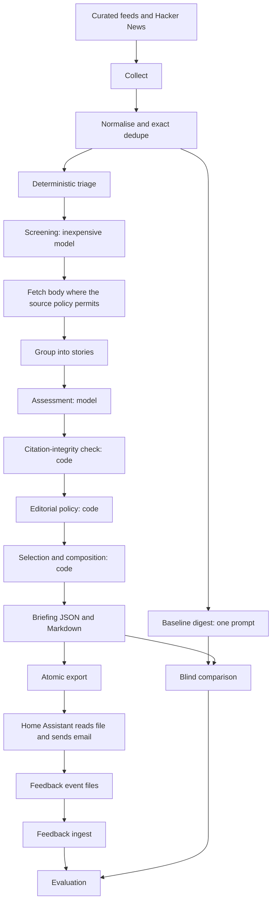
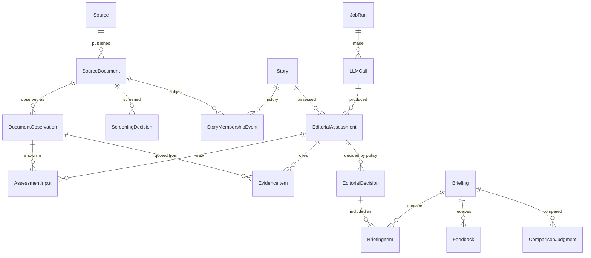
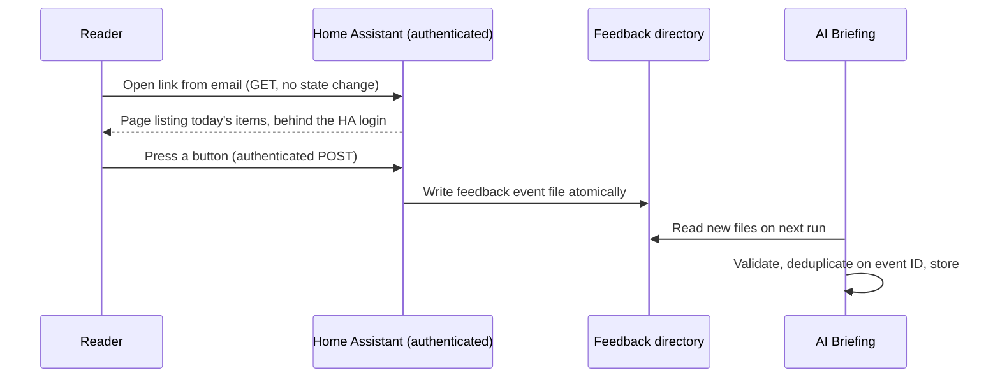

# AI Briefing — RFC v0.3

**Status:** Proposed. Not accepted; implementation has not been authorised.
**Date:** 2026-11-19; revised 2026-11-21 (model provider, source catalogue draft, M1 sequence)
**Supersedes:** RFC v0.1 (architecture packet v0.2)
**Licence:** Apache-2.0
**Repository:** `sdeery14/ai-briefing` (public)
**Initial deployment:** `homenvr`, the Home System Raspberry Pi 4B (8 GB)
**Decision records:** [ADRs 001–011](../adr/README.md), all Proposed
**Plan:** [`docs/planning/milestones.md`](../planning/milestones.md)
**Review trail:** [`docs/reviews/`](../reviews/), in particular [`v0.3-reconciliation.md`](../reviews/v0.3-reconciliation.md) and [`v0.3-open-questions.md`](../reviews/v0.3-open-questions.md)

## What changed since v0.1

| Area | v0.1 | v0.3 |
|---|---|---|
| Order of work | Evaluator, knowledge base, research and curriculum before the first briefing | A readable daily briefing in M1; on the Pi and in the morning email in M2 |
| Baseline | None | A single-prompt digest that the pipeline must beat in blind comparison |
| Education | Full curriculum in V1 | A short optional concept note in V1; the persistent curriculum is M6 |
| Evaluation | Blind holdout on a 40-case benchmark | Deterministic gates now; prospective owner labelling as the primary measure; the benchmark is a smoke test |
| LLM judges | Five calibrated judges planned | Diagnostic only until human calibration shows they are reliable |
| Evidence | Document IDs on an assessment | Evidence records with quotes, integrity checks, source roles and corroboration |
| Editorial decisions | One model output | Model assessment, then deterministic policy, then deterministic selection |
| Discovery | Feeds, community, search and research in V1 | Curated sources and Hacker News; search and research wait for measured gaps |
| Observability | MLflow spans on every stage | SQLite and JSON logs as the record; MLflow optional on model calls |
| Cost | Unstated | $15 per month, enforced before each model call |
| Feedback | An entity with no input path | Authenticated Home Assistant interaction writing event files |
| Workflow | `/round` with listed cautions | Human merges first; auto-merge only behind enforced GitHub controls |
| New decisions | — | ADR-010 content rights and retention; ADR-011 development workflow |

---

## 1. Product thesis

AI Briefing is an evidence-first intelligence and education service for a data scientist or AI engineer. It collects developments in AI, machine learning, data science and software engineering through the day, works out which ones matter and how well they are supported, and prepares a morning briefing that can be read in about five minutes.

The promise is unchanged: **signal over hype, evidence over virality, cumulative learning over random tips.**

The long-term product has two halves. Industry intelligence comes first because it can be validated quickly and everything else depends on it. Structured continuous education remains a planned milestone (M6), not an abandoned feature. Until then, V1 carries a lightweight educational element described in §6.4.

### 1.1 The baseline the product must beat

A single prompt that summarises the day's collected items is a one-day build. It is implemented in M1 and kept permanently as a comparison arm. The pipeline in this RFC is justified only if the owner prefers its briefings to the baseline's in blind comparison. If it does not, the response is to simplify the pipeline, not to add to it.

### 1.2 Target journey for V1

1. Install with a local SQLite database and a starter source catalogue. No Home Assistant, email or MLflow is required.
2. Scheduled jobs collect and process sources. New and updated stories are stored with their provenance.
3. Each morning the system produces a briefing of up to five developments, a short watchlist, and a concept note when one is useful. A quiet day produces a shorter briefing.
4. The briefing is readable locally as Markdown. On the Home System, the existing 07:00 email includes it in full, with links to sources.
5. The reader opens an authenticated page from the email and marks items as useful, not useful or overhyped, or reports something missed. Those judgements feed evaluation.

---

## 2. Scope

### 2.1 V1 (milestones M1 to M4)

- Python package with a CLI, Apache-2.0.
- Curated source catalogue: official and research sources by RSS or Atom, release feeds, and Hacker News.
- Normalisation, exact deduplication and story grouping with a recorded history.
- Two model tiers from one provider: inexpensive screening and standard assessment, with escalation to a more capable model for stories that warrant it.
- Evidence records, citation-integrity checks and a deterministic editorial policy.
- A deterministic composer producing versioned JSON and Markdown.
- A concept note connected to a current development, when useful.
- The single-prompt baseline digest and blind comparison.
- A hard, application-enforced model budget, provisionally $15 per month.
- SQLite as the system of record, with job and model-call records and structured logs.
- Optional MLflow tracing of model calls.
- Container deployment on the Pi with scheduled jobs, off-device backup and a tested restore.
- File handoff to Home Assistant and a file-based feedback path back.
- Prospective evaluation from owner feedback and weekly labelling.

### 2.2 Planned after V1

| Capability | Milestone | Condition for starting |
|---|---|---|
| Additional sources, search-based discovery, targeted research | M5 | Measured coverage or evidence gaps |
| Persistent curriculum, prerequisites, progress and assessment | M6 | The intelligence briefing is in daily use and the feedback path works |

### 2.3 Not planned

Public web UI, hosted service, accounts, multi-tenant use, mobile app, vector database, distributed task queue, local model inference, autonomous source onboarding, model-directed web fetching, self-modifying prompts or rubrics, a second email sender, an internet-facing API, automatic deployment to the Pi, redistribution of third-party article text.

Anything in §2.2 or §2.3 moves earlier only through a new or superseding ADR.

---

## 3. Architecture

One Python modular monolith run as short-lived CLI jobs (ADR-001). Orchestration is plain Python (ADR-009). State lives in SQLite (ADR-002). There is no long-running process.

### 3.1 Pipeline



Every stage reads rows in a known state and writes its result in one transaction. A job that is interrupted is resumed by running it again.

### 3.2 Who decides what

| Decision | Made by |
|---|---|
| Canonical URL, exact duplicate, scope and freshness filters | Code |
| Whether an item is worth assessing | Inexpensive model, recorded as a screening decision |
| Whether a body may be fetched and kept | Code, from the source policy |
| Story membership by shared link | Code |
| Story membership by topic (from M3) | Code shortlists; model answers yes or no for a shortlisted story |
| Claims, supporting quotes, dimension scores, suggested class | Model |
| Whether cited IDs were supplied and quotes appear in the stored text | Code |
| Final class and eligibility | Code, from the assessment and the policy rules |
| Escalation to the capable model | Code, from class, uncertainty and remaining budget |
| Reassessment | Code, from the triggers in §6.3 |
| Selection, order, repetition and duplicate suppression | Code |
| Headline, summary, "why it matters", concept note text | Model, stored and reused |
| Budget, dates, time zones, rendering, export | Code |

### 3.3 Modules

| Module | Owns | Does not own |
|---|---|---|
| `domain` | Typed records, enumerations, pure rules. Imports no I/O library. | Persistence, network |
| `sources` | Source catalogue, adapters, fetcher, network policy, source health | Editorial judgement |
| `stories` | Canonicalisation, deduplication, grouping, membership history | Prompts |
| `editorial` | Screening, assessment contracts, evidence, integrity checks, policy rules | Fetching, sending |
| `briefings` | Selection, composition, concept note, baseline digest, rendering, export | Recipients, scheduling, email |
| `feedback` | Feedback event contract and ingestion | Any Home Assistant code |
| `llm` | The one provider client, structured output, model-call log, price table, budget | Editorial rules |
| `evaluation` | Metrics, comparison analysis, labelling worksheets, reports | Runtime decisions |
| `storage` | Schema, migrations, repositories | Policy |
| `runtime` | CLI, configuration, file lock, structured logging, tracer protocol | Domain rules |

`research` and `learning` are reserved names for M5 and M6.

### 3.4 Repository layout

The layout is fixed here because protected paths in ADR-011 are expressed as globs over it.

```text
src/ai_briefing/<module>/        application code
src/ai_briefing/prompts/         versioned prompt files               (protected)
src/ai_briefing/editorial/policy/ editorial policy rules              (protected)
src/ai_briefing/evaluation/      evaluation code and metrics          (protected)
config/sources.yaml              source catalogue and usage terms     (protected)
config/models.yaml               model IDs, price table, budgets      (protected)
schemas/                         briefing and feedback contracts      (protected)
evals/                           public cases, golden files, recorded responses (protected)
migrations/                      Alembic migrations                   (protected)
deploy/                          container, compose, systemd units    (protected)
docs/rfc/, docs/adr/             decisions                            (protected)
.github/, .claude/, scripts/, AGENTS.md, CLAUDE.md   workflow and agent instructions (protected)
pyproject.toml, uv.lock          dependencies                         (protected)
tests/                           tests and synthetic fixtures
```

### 3.5 CLI (conceptual)

| Command | Purpose |
|---|---|
| `ai-briefing db upgrade` | Apply migrations |
| `ai-briefing sources list` / `sources check` | Show the catalogue and source health |
| `ai-briefing collect [--source NAME]` | Fetch new items |
| `ai-briefing process` | Triage, screen, fetch, group, assess, verify, decide |
| `ai-briefing briefing generate --date D` | Compose and store the briefing |
| `ai-briefing briefing export --date D` | Write the contract file atomically |
| `ai-briefing baseline generate --date D` | Produce the single-prompt digest |
| `ai-briefing compare --date D` | Show both briefings unlabelled and record a preference |
| `ai-briefing feedback ingest` | Read feedback event files |
| `ai-briefing eval run` | Run offline evaluation and write a result file |
| `ai-briefing retention purge` | Apply the retention policy |
| `ai-briefing backup` | Write a consistent snapshot |
| `ai-briefing budget status` | Show spend against the cap |
| `ai-briefing doctor` | Database, sources, last runs, budget, disk |

Clock, HTTP transport and model client are injected so tests run offline and deterministically.

---

## 4. Information lifecycle

1. **Collect.** An adapter returns typed candidates: source, external ID, URL, title, published time if the source gives one, summary if supplied. Published time is never guessed.
2. **Normalise and deduplicate.** Canonicalise the URL. Match on `(source, external ID)`, canonical URL and content hash. Each fetch creates an observation, so later edits do not overwrite history.
3. **Triage (code).** Drop items already processed, outside the freshness window, malformed, or from a disabled source. Low popularity alone never drops an item.
4. **Screen (inexpensive model).** Batched titles and summaries are rated for relevance to the reference audience. Every outcome is stored with its reason so missed items can be audited later.
5. **Fetch body (code).** Only for items that passed screening, only from catalogued sources whose recorded terms permit it, and only through the network policy in §11. Other items remain metadata-only.
6. **Group.** In M1, documents that share a canonical URL or link to the same URL form one story. From M3, a lexical shortlist of recent stories is confirmed by a constrained model answer. Every membership change is an append-only event.
7. **Assess (model).** The model receives a snapshot of observations identified by ID. It returns claims with supporting quotes, five dimension scores, an uncertainty note, a suggested class, and draft text. The exact inputs are recorded.
8. **Verify (code).** Citation integrity only: each cited ID was in the input, each quote occurs in the stored text, each observation predates the assessment. Failures are recorded and the item is excluded from support.
9. **Decide (code).** The editorial policy sets the final class within a ceiling derived from evidence facts (§6.2). The decision is stored separately from the assessment so a policy change does not require new model calls.
10. **Escalate (code, then model).** Stories that the policy marks as potentially major, or that have high uncertainty, are reassessed once by the capable model if the budget allows.
11. **Compose (code).** Select eligible stories, suppress repeats and near-duplicates, order them, attach the concept note if one qualifies, and store an immutable briefing version.
12. **Export.** Validate against the schema, write to a temporary file, rename atomically.
13. **Learn from feedback.** Ingest feedback events and comparison judgements for evaluation. Feedback never edits a stored assessment.

**Core rules.** Popularity is a discovery signal, not evidence. A vendor is authoritative for the existence of its release, not for comparative claims about it. A verified quote shows that the source said something; it does not show that the claim is true or that the quote supports it. Uncertainty must survive into the text the reader sees.

---

## 5. Data model

SQLite with SQLAlchemy and Alembic (ADR-002). Entities are logical; field lists are representative.



| Entity | Representative fields | Invariant |
|---|---|---|
| `Source` | name, kind, URL, default source role, enabled, polling interval, terms URL, terms reviewed date, body fetch permitted, body retention days, excerpt limit, rate limit; operational state: feed cache validators, last successful fetch, consecutive failures | Usage terms are recorded before a source is enabled |
| `SourceDocument` | source, external ID, canonical URL, title, published time (nullable), first seen, source role | Stable identity; no guessed dates |
| `DocumentObservation` | document, retrieved at, fetch status, cache validators, summary, body text (nullable), body purged at, content hash | Append-only; the hash survives purging |
| `ScreeningDecision` | document, outcome, relevance, reason, model call | Every screened item has a recorded outcome |
| `Story` | title, state (open, dormant, closed), first seen, last activity, merged into, last briefed decision | Never deleted; merges leave a redirect |
| `StoryMembershipEvent` | story, document, action (add, remove, merge-in), reason, decided by (rule or model call), time | Append-only. `StoryDocument` is the current-state table, updated in the same transaction |
| `EditorialAssessment` | story, as-of time, input hash, prompt hash, model ID, rubric version, tier (standard, escalated), five scores, suggested class, uncertainty, draft text, model call | Immutable. Unique on story, input hash, prompt hash and model ID |
| `AssessmentInput` | assessment, observation | The exact inputs shown to the model |
| `EvidenceItem` | assessment, claim text, observation, quote, support type (supports, contradicts, context), integrity status (verified, failed), support label (unreviewed, or a later human or judge label) | Integrity and semantic support are separate fields |
| `EditorialDecision` | assessment, policy version, final class, ceiling, ceiling reasons, independent source count, eligible | Append-only; recomputed when the policy version changes |
| `Briefing` | local date, time zone, variant (pipeline, baseline), version, status, content, content hash, configuration hash, profile | Immutable versions; unique on date, variant and version |
| `BriefingItem` | briefing, position, kind (story, watch, concept note), story, decision, text, inclusion reason | Every inclusion is traceable to a decision |
| `ConceptNote` | briefing, concept key, title, body, related story, model call | Used to avoid repeating a concept |
| `Feedback` | event ID, briefing, item, kind, value, note, recorded at, source, profile | Idempotent on event ID; never alters shared assessments |
| `ComparisonJudgment` | local date, two briefing IDs, presentation order, choice, recorded at | The reader did not know which was which |
| `Label` (M4) | target, kind, value, labelled at, blind flag, revises | Decision-time labels and later revisions are kept apart |
| `LLMCall` | job run, purpose, prompt ID and hash, provider, model ID, tokens in and out, estimated cost, price table version, latency, status, error class, retries, request and response references | Written for every call, including failures and refusals by the budget check |
| `JobRun` | job, idempotency key, start, end, status, counts, error, application version, configuration hash | Re-running a completed key is a no-op |

Notes:

- Prompts are files identified by content hash. They need no table.
- Budget state is derived from `LLMCall` rows for the current calendar month.
- Request payloads referenced by `LLMCall` contain source text and follow the same retention rule as bodies (ADR-010). Responses are kept.
- `Briefing.profile`, `Feedback.profile` hold a single default value in V1. This is the seam for later personalisation.
- Reserved for later: `ResearchRun` (M5); learning tracks, lessons and progress (M6).
- Timestamps are UTC. A briefing also stores its local date and time zone.

---

## 6. Editorial policy

### 6.1 Assessment

The model scores five dimensions from 0 to 4: impact, evidence, novelty, professional relevance, maturity. Each level of each dimension has a written anchor in the rubric file. Professional relevance is judged for one stated reference audience (a practising data scientist or AI engineer). The dimensions are never collapsed into a weighted sum.

The output schema places claims and evidence before scores and the suggested class. The model cites only observation IDs it was given and supplies a verbatim quote for each supporting citation. It never outputs a URL.

### 6.2 Policy (code)

Classes: `major`, `practical`, `watch`, `low`.

The final class is the lower of the model's suggested class and a ceiling computed from facts:

| Fact | Effect |
|---|---|
| No evidence item passed the integrity check | Ceiling `watch` |
| Story is metadata-only (no body was permitted or fetched) | Ceiling `watch` |
| All supporting sources are the vendor, and the claim is comparative or about performance | Ceiling `watch` |
| All supporting sources are the vendor, and the claim is that a release exists | Ceiling `practical` |
| Fewer than two independent sources | Cannot be `major` |
| Only community or aggregator sources | Ceiling `watch` |

Independent corroboration counts distinct primary or independent-reporting sources. Several articles repeating one announcement count once. Source roles are: primary, vendor, independent, community, aggregator.

The table is the starting policy. The rules are versioned, live in a protected path, and change only with owner review. They are the owner's editorial policy expressed as code.

### 6.3 Reassessment, freshness and repetition

- **Reassess** when the set of observations for a story changes, or when the prompt, rubric or model changes for a story that is still open. Otherwise the stored assessment stands.
- **Re-decide** when the policy version changes or a new assessment exists. No model call is needed.
- **Freshness.** New stories are eligible for a briefing while their newest evidence is inside a configured window (default 72 hours). When a source gives no published time, first-seen time is used and flagged. A story with no activity for seven days becomes dormant.
- **Repetition.** A story already included in a briefing is eligible again only if its final class changed or a new primary or independent evidence item arrived since then.
- **Duplicate suppression** applies at three levels: documents (identity and hash), stories (grouping), and briefings (the repetition rule plus a title-similarity check within one briefing).

### 6.4 Concept note

V1 keeps the educational thread with one optional element. When one of the day's selected stories turns on a technical concept that the reference audience may not know well, the briefing includes a short explanation of it (about 120 words) tied to that story.

- It is omitted when nothing qualifies. There is no quota.
- It is labelled as background written by the model. It cites only the day's source documents by ID and contains no other links.
- A concept key is stored so the same concept is not repeated within 30 days.
- The stored keys are an input to curriculum design in M6: they show which concepts current developments actually require.

### 6.5 Selection

Selection is deterministic. Eligible stories are ordered by class, then by a documented tuple of dimension scores. At most five are included, fewer when fewer qualify. `watch` items appear as a short list. The inclusion reason is stored for each item.

---

## 7. Models, cost and degradation

One provider: **Anthropic**, through the Claude API (ADR-009). Model identifiers and the price table live in `config/models.yaml`, which is a protected path.

| Tier | Model ID | Used for |
|---|---|---|
| Inexpensive | `claude-haiku-5-5` | Screening, standard assessment, baseline digest, concept note |
| Capable | `claude-sonnet-5-5` | Escalated assessment of stories that may be `major` or have high uncertainty |

### 7.1 Verified model facts

Checked against Anthropic's models overview and pricing pages on 2026-11-21. Prices are US dollars per million tokens on the first-party API.

| | `claude-haiku-5-5` | `claude-sonnet-5-5` |
|---|---|---|
| Input | $0.10 (prompts up to 100,000 tokens); $0.50 above | $2.00 |
| Output | $0.50 (prompts up to 100,000 tokens); $2.50 above | $10.00 |
| Cache read | $0.01; $0.05 above the threshold | $0.10 |
| Cache write, 5 minutes | $0.125; $0.625 above the threshold | $2.50 |
| Batch API (50% discount) | $0.05 in, $0.25 out; $0.25 and $1.25 above the threshold | $1.00 in, $5.00 out |
| Context window, maximum output | 1M tokens, 128K tokens | 1M tokens, 128K tokens |
| Default effort | `medium` | `high` |
| Structured output (`output_config.format`) | Supported | Supported |
| Earliest retirement | 7 October 2027 | 28 September 2027 |
| Reliable knowledge cutoff | June 2026 | June 2026 |

Both identifiers are pinned snapshots, not moving aliases.

Consequences for the design:

- **Keep inexpensive-model prompts under 100,000 tokens.** A request over the threshold is billed at five times the rate for the whole request. Screening is batched to stay under it, and the pre-call cost estimate applies the higher rate if a prompt would cross it.
- **Thinking is billed as output.** Both models think adaptively. The pre-call estimate therefore uses the request's output limit, and effort is set explicitly per task (low for screening) instead of relying on defaults.
- **Sampling cannot be pinned.** Non-default `temperature`, `top_p` and `top_k` are rejected on these models, so identical inputs can give different outputs. This is why run-to-run variability is measured (ADR-007) and why raw responses are stored.
- **Scores are enumerations.** Structured output does not enforce numeric ranges or string lengths. The 0–4 scores are declared as enumerated values, and length limits are validated in code after the response.
- **Refusals are a normal outcome.** A response can end with a `refusal` stop reason, for example on some security content. The call is recorded as refused and the story stays unassessed; the run continues.
- **No forced tool choice.** `claude-sonnet-5-5` rejects it. The design does not use tools, so this costs nothing.
- **Hindsight.** Both models' knowledge ends in June 2026. News collected from now on post-dates it, which is what makes prospective evaluation clean.

Two cost levers are available and not used in M1: the Batch API, which halves the price but is asynchronous, and prompt caching for the stable rubric prefix.

### 7.2 Budget

A provisional cap of **$15 per calendar month**, enforced by the application. It will be revised once real volume and cost have been measured in M1.

The prices above are verified. Volumes are not. As an illustration only, with assumed volumes:

| Stage | Assumed daily volume | Approximate daily cost |
|---|---|---|
| Screening (inexpensive) | 1,000 items at 400 input and 60 output tokens each | $0.07 |
| Standard assessment (inexpensive) | 40 stories at 5,000 input and 2,000 output tokens each | $0.06 |
| Escalation (capable, from M3) | 5 stories at 8,000 input and 3,000 output tokens each | $0.23 |
| Baseline digest and concept note | Two calls | Under $0.02 |

That is roughly $0.38 a day, about $11 a month, with escalation the largest share. Whether the assumptions hold is the first thing M1 measures.

- Before every call, the client estimates the maximum cost from the input size, the output limit and the price table. If that would exceed the remaining monthly budget or the day's allowance, the call is not made and the refusal is recorded.
- Actual usage from the provider's response is recorded after each call.
- A spending limit set at the provider is recommended as a second, independent control.

### 7.3 Shedding and degraded behaviour

**Priority when the budget is tight.** Calls are shed in this order: experimental judges, baseline digest, escalation, concept note, standard assessment (lowest-relevance stories first), screening.

**Degraded behaviour.**

| Condition | Result |
|---|---|
| Day's allowance exhausted before all stories are assessed | Briefing built from the stories that were assessed; status `degraded`, reason `budget` |
| Monthly cap reached | Briefing lists unassessed headlines from primary sources, clearly marked as unassessed; status `degraded` |
| Provider unavailable | Retry within the morning window, then compose from existing assessments; status `degraded`, reason `provider` |
| Nothing eligible | Status `empty`; Home Assistant omits the section |

No multi-provider routing layer is introduced. The assessment interface is defined at task level so a second implementation can be added later without one.

---

## 8. Briefing contract and Home Assistant

The briefing is a data product. Home Assistant remains the owner of recipients, personal context, the email itself and sending (ADR-006). AI Briefing never sends email and never calls Home Assistant.

### 8.1 Verified facts about the existing email

From the Home System repository on 2026-11-19: the morning email is produced by a custom Home Assistant integration. An automation triggers it at 07:00 local time. The integration gathers personal context, makes one model call that writes a short note of about 150 words in a fixed persona, renders HTML with escaped content, and sends through a transactional email API. Home Assistant runs as a container and already has an HTTPS endpoint reachable from the owner's devices.

### 8.2 Outbound contract: `daily_briefing.v1`

```json
{
  "schema_version": "daily_briefing.v1",
  "briefing_id": "b-2026-11-19-1",
  "local_date": "2026-11-19",
  "timezone": "America/New_York",
  "generated_at": "2026-11-19T11:15:00Z",
  "status": "ready",
  "degraded_reasons": [],
  "stories": [
    {
      "item_id": "i1",
      "story_id": "s-123",
      "decision_id": "d-456",
      "class": "practical",
      "confidence": "moderate",
      "headline": "Example development",
      "summary": "What happened, in two or three sentences.",
      "why_it_matters": "A concise, evidence-based explanation.",
      "independent_source_count": 2,
      "evidence": [
        {"title": "Original announcement", "url": "https://example.org/a", "source_name": "Example Lab", "source_role": "vendor"}
      ]
    }
  ],
  "watchlist": [
    {"item_id": "i4", "headline": "Unconfirmed claim worth watching", "url": "https://example.org/b"}
  ],
  "concept_note": {
    "title": "Example concept",
    "body": "Short model-written background.",
    "related_item_id": "i1"
  }
}
```

The example is illustrative. The JSON Schema in `schemas/` is authoritative and sets maximum lengths and counts.

- `status` is one of `ready`, `degraded`, `empty`. `confidence` is one of `low`, `moderate`, `high`.
- `concept_note` is optional. The name `lesson` is reserved for M6.
- Every URL is resolved from a stored document. Model output never supplies a URL.
- The exporter writes `latest.json` by atomic rename and keeps dated versions for audit.

### 8.3 Consumer rules

These are requirements on the Home Assistant side, implemented in the Home System repository by the owner.

1. Accept the file only if it validates against the schema, `local_date` is today in the stated time zone, and `status` is not `empty`. Otherwise omit the section, log a diagnostic, and send the existing email unchanged.
2. Render the full briefing in the email as its own section after the existing personal content: headline, summary, why it matters, class and confidence, and source links for each story; then the watchlist and the concept note.
3. Render from the structured fields with the integration's own escaping. Allow only `http` and `https` links.
4. **Never pass briefing content into the integration's model prompt.** It is derived from untrusted web content, and that prompt has access to personal context.
5. Read the file; never read the SQLite database, call AI Briefing, or write to its export directory.

Delivery idempotency stays with Home Assistant.

### 8.4 Feedback path

Feedback must be an intentional, authenticated action. Email link scanners and clients that prefetch links issue `GET` requests, so a `GET` must never record anything.



- The email links to a page served by Home Assistant that requires an authenticated Home Assistant session, in the same way as the existing chat panel. Opening it shows the day's items. Nothing is recorded until the reader presses a control, which issues an authenticated `POST`.
- Home Assistant writes one `feedback_event.v1` JSON file per action to a directory it can write and AI Briefing can read.
- AI Briefing treats these files as external input: strict schema validation, size limits, rejection of unknown briefing or item IDs, idempotency on event ID.
- Event kinds in V1: `useful`, `not_useful`, `overhyped`, `missed` (with a free-text note), `note`.

If the login step proves too awkward on a phone, the fallback is a page reached by a signed, expiring token that shows a confirmation form and records only on `POST`. It is weaker and is not the default. See open question Q5.

### 8.5 Standalone use

Without Home Assistant, the Markdown rendering is the reading surface and the `compare` and feedback commands are used from the CLI.

---

## 9. Deployment and operations

ADR-008 holds the decisions. This section records the facts they rest on.

### 9.1 Host facts taken from the Home System repository

| Fact | Source status |
|---|---|
| Raspberry Pi 4B, 8 GB, wired Ethernet | Documented |
| Raspberry Pi OS Lite (Debian Trixie), 64-bit, with Docker and systemd | Documented |
| Home Assistant runs as a container with host networking in a Docker Compose stack, alongside an MQTT broker | Documented |
| MLflow tracking server with PostgreSQL 16 and MinIO in the same stack | Documented |
| MLflow server image tag is not pinned; the Home System's clients require MLflow 3.11 or later for evaluation and 2.20 or later in the integration | Documented; running version unknown |
| Boot media is microSD; a USB SSD is planned for camera storage | Documented as planned, not as installed |
| A camera recorder (Frigate) is planned on the same host | Documented as planned |
| No off-device backup of the MLflow data is described as implemented | Not found |

Home Assistant is not Home Assistant OS, so host timers and a separate container are available. The remaining unknowns are measurements that can only be taken on the host.

### 9.2 Verification required before deployment (M2 gate)

Storage medium, free space and write endurance for the data directory; free memory and CPU load with current services; operating system and architecture as actually installed; running MLflow server version and compatibility of the tracing client; outbound network policy as applied to the container; a completed restore from an off-device backup.

### 9.3 Runtime shape

- A separate container and Compose project, not an addition to the Home System stack. Memory and CPU limits set.
- Host systemd timers run short-lived commands. Collection about every three hours; processing after collection; composition at about 06:15 local; export by 06:30; a retry window until 06:45.
- An OS file lock ensures one writer. Idempotency keys in `JobRun` make re-runs safe.
- SQLite in WAL mode on reliable persistent storage, not on the boot microSD.
- A nightly consistent snapshot copied off the device. A restore is tested before first real use.
- The image is built for ARM64 in CI and pulled manually by the owner. There is no CI runner on the Pi and no automatic deployment.
- The export directory is mounted read-only into Home Assistant. The feedback directory is writable by Home Assistant and read-only to AI Briefing.

---

## 10. Evaluation and observability

The two are kept separate. Observability answers "what happened"; evaluation answers "was it good".

| | Observability (ADR-009) | Evaluation (ADR-007) |
|---|---|---|
| Question | What ran, with which versions, at what cost, and what failed | Whether the output was correct and useful |
| Record | `JobRun`, `LLMCall`, structured JSON logs | `Feedback`, `ComparisonJudgment`, `Label`, evaluation result files |
| Code | `runtime`, `llm` | `evaluation`, plain Python with no MLflow dependency |
| MLflow | Optional tracing of model calls and job roots | Optional experiment tracking of result files |
| Needed for correctness | No | No (but deterministic checks gate CI) |

### 10.1 Observability

SQLite is the system of record. Jobs emit structured JSON logs. Every model call is persisted with prompt hash, model identifier, token counts, cost and latency. A `Tracer` protocol has a no-op default and an MLflow implementation that wraps model calls, job roots and a few important operations such as composition and export. Tracing uses the lightweight MLflow client, flushes with a short bounded timeout at job end, and is tested with the server unreachable. Traces carry identifiers and metadata by default, not article text. The Home System MLflow store is reachable from development machines and is treated as readable by coding agents.

### 10.2 Evaluation

- **Deterministic tests are the hard gates.** Schema validity, deduplication, idempotent re-runs, date logic, citation integrity, policy ceilings, budget enforcement, and replay of recorded model responses.
- **Prospective evaluation is the primary quality measure.** Each new day is a case that prompts and models could not have seen. The owner spends about 15 to 20 minutes a week on feedback and labelling.
- **Blind comparison against the baseline** tests whether the pipeline earns its complexity.
- **The 40-case benchmark is a calibration aid and smoke test.** It is not a statistically reliable gate.
- **LLM judges may be used early, for diagnosis only.** Their output is stored as diagnostic and never gates anything until calibration against owner labels shows they are reliable and the owner approves.
- **Every reported metric carries its sample size and an uncertainty interval.** Run-to-run variability is measured and used as the noise band for comparisons.
- **Citation integrity and semantic support are reported separately.** The first is checked by code. The second is judged by a person on a sample.
- **No accuracy thresholds are set** until a trustworthy baseline exists.

---

## 11. Security, privacy and content boundaries

- **Untrusted content.** Everything fetched is data, never instructions. Prompts say so, outputs are schema-validated, and the deterministic policy limits what persuasive source text can achieve.
- **No model-directed fetching.** The model never chooses a URL, has no tools, and cannot trigger a network request.
- **Network policy.** HTTPS by default; allowed schemes only; destination addresses checked after DNS resolution and again on every redirect, refusing private, loopback and link-local ranges; redirect limit; timeouts; maximum response size; per-host rate limits. The host also runs home automation, so these controls have acceptance tests.
- **Rendering.** URLs come only from stored documents. All model and source text is escaped. The Home Assistant integration never places briefing content in its own model prompt.
- **Feedback.** Authenticated, intentional, `POST`-only state change; event files validated as external input.
- **Secrets.** API keys stay out of Git, logs, traces and prompts. AI Briefing has its own provider key and never holds Home Assistant or email credentials.
- **Content rights and retention.** ADR-010: metadata and permitted summaries are kept; fetched bodies are kept privately for up to 90 days where the source's terms permit; only permitted excerpts and hashes are kept longer; no third-party article text enters the repository.
- **Private data.** No personal data, credentials or benchmark holdout labels in the repository, CI, traces or any agent-accessible location. The private answer key is not stored on a machine or account where a coding agent runs.
- **Supply chain.** Dependencies are pinned through the lock file. Dependency, workflow and deployment changes require owner review (ADR-011).

---

## 12. Milestones

Full plan and issue breakdown: [`docs/planning/milestones.md`](../planning/milestones.md).

| Milestone | Delivers | Observable exit |
|---|---|---|
| **M0** Safeguards | Licence, agent instructions, repository protections, CI, `/round` without merge, model and source configuration | A test pull request is blocked from merging without owner action |
| **M1** Working briefing | The first real briefing after six issues; then daily runs, the baseline digest and hardening | Build criteria pass; fourteen consecutive daily briefings each with a recorded blind preference; an exit report |
| **M2** Delivery | Pi deployment, morning email section, feedback path, backup and restore. Preparation may overlap the M1 comparison; deployment needs the owner's authorisation after the M1 and safeguard gates pass. | The email carries the briefing on healthy days and is unchanged on a forced failure; a feedback action reaches the database; a restore succeeds |
| **M3** Trust | Topic-based story grouping, source roles and corroboration, full policy, escalation, reassessment and repetition rules | A scripted day with a duplicate, a real update and a vendor-only claim is handled as specified; no integrity violation reaches a briefing |
| **M4** Evaluation | Weekly labelling routine, recall analysis, later revisits, variability measurement, experimental judges | A baseline report with sample sizes and intervals; one prompt change compared against it |
| **M5** Coverage | Sources, search or research justified by M4 findings | A measured improvement beyond the noise band |
| **M6** Curriculum | Persistent tracks, prerequisites, progress and checks | Lessons delivered in order with progress recorded only from evidence |

---

## 13. Open questions

Only genuinely unresolved items remain, each with a recommended default, in [`docs/reviews/v0.3-open-questions.md`](../reviews/v0.3-open-questions.md). The model provider is decided (§7). The initial source list is drafted in [`docs/planning/source-catalogue-draft.md`](../planning/source-catalogue-draft.md) and awaits the owner's editorial approval before any collection. Four questions about deployment remain explicitly open and gate M2: storage, backup destination, email placement and feedback authentication.

Nothing in this document authorises implementation. Work begins when the owner accepts the RFC and the ADRs.
